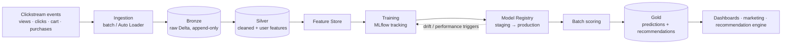

# 🛒 E-commerce Lakehouse ML Pipeline: Solution Design

**Architecture design for a Databricks lakehouse that turns e-commerce clickstream into purchase predictions and product recommendations.**

> **Scope:** this repository is a **design document**. It covers the architecture, pipeline flow and model-retraining strategy, written as a solution-design exercise. It contains no implementation code.

---

## Problem

An e-commerce business wants to know **which users are likely to buy** and **what to recommend to them**, using behavioural events (views, clicks, add-to-cart, purchases), with a pipeline that keeps the models accurate as behaviour changes.

## Architecture

## Pipeline flow

| Stage | Responsibility | Key outputs |
|---|---|---|
| **Ingestion** | Land raw events in Delta (batch, or Auto Loader for incremental files) | append-only event tables |
| **Bronze** | Keep events exactly as received, for traceability and replay | `user_events`, `product_clicks`, `transaction_logs` |
| **Silver** | Deduplicate, handle nulls, standardise timestamps, aggregate per user | `total_events`, `total_spent`, `number_of_purchases`, `average_product_price`, `distinct_products_viewed` |
| **Feature Store** | Serve the same user features to training and scoring | versioned feature tables |
| **Training** | Logistic Regression / Random Forest for purchase propensity; ALS collaborative filtering for recommendations; experiments tracked in MLflow | candidate models with metrics |
| **Model Registry** | Lifecycle: development → staging → production; promote only if the metric improves | production model version |
| **Batch scoring** | Apply the production model to fresh user features | `purchase_probability`, `recommended_products` |
| **Gold** | Curated outputs for the business | `customer_purchase_predictions`, `product_recommendations`, aggregated metrics |

## Retraining strategy

- **Scheduled:** retrain weekly or monthly on new activity data.
- **Data drift:** monitor feature distributions and trigger retraining on significant shift.
- **Performance:** trigger retraining when AUC or accuracy falls below a threshold.
- **Versioning:** every retrain registers a new model version. Compare it with production, promote if better, otherwise discard.

## Design decisions

- **Medallion layers** separate raw retention (Bronze) from business logic (Silver/Gold), so features can be rebuilt from history.
- **A feature store** keeps training and scoring features identical, avoiding training/serving skew.
- **Batch, not real-time, scoring:** propensity and recommendations change slowly, so a scheduled batch job is cheaper and simpler than an online endpoint.

## Stack

Databricks · Apache Spark · Delta Lake · Spark MLlib · MLflow (tracking + registry) · Databricks Feature Store

## Next step

Implement the design end to end in a Databricks notebook project: Auto Loader ingestion, Silver feature tables, an MLflow-tracked propensity model, and a scheduled batch-scoring job.
